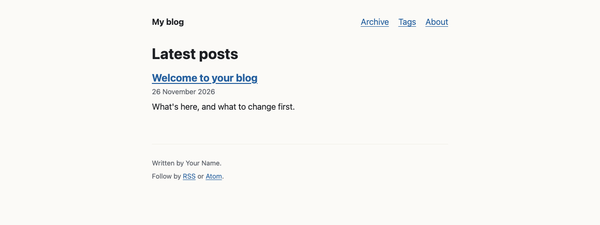

# Sheaf

Static sites with templates in Elm.

[][licence]
[][ci]

Sheaf is a static site generator for Elm developers who want a blog, or a
small site of their own, without an application framework. Your content is
Markdown with frontmatter, your pages are typed Elm functions, and the result
is a folder of plain HTML and CSS with no JavaScript in it.

Sheaf checks what a static site usually gets wrong before it ships: a
misspelled frontmatter field, a link to a post that doesn't exist, a code block
in a language it can't highlight, or an image that isn't there all fail the
build with a message that points at the line.

```
-- UNKNOWN FIELD ---------------------------------- content/posts/welcome.md:4:1

This document has a `sumary` field, but its collection does not declare one.

    4| sumary: What's here, and what to change first.
       ^^^^^^

Did you mean `summary`?
```

The starter looks like this:



## A short example

A post is a Markdown file in `content/posts/`, with directives for components
that you write in Elm:

```markdown
---
title: Welcome to your blog
date: 2026-11-25
summary: What's here, and what to change first.
tags: [Sheaf]
---

:::callout
`bunx sheaf dev` rebuilds the site and reloads the browser whenever you save.
:::
```

`src/Site.elm` declares what the frontmatter holds, and which templates render
it:

```elm
type alias PostMeta =
    { title : String
    , summary : Maybe String
    , tags : List String
    }


postFrontmatter : Frontmatter PostMeta
postFrontmatter =
    Frontmatter.succeed PostMeta
        |> Frontmatter.required "title" Frontmatter.string
        |> Frontmatter.optional "summary" Frontmatter.string
        |> Frontmatter.withDefault "tags" [] (Frontmatter.list Frontmatter.string)
```

Both come from the starter that `sheaf init` writes. The starter uses the blog
preset, `Sheaf.Blog`, which makes posts, pages, a paginated index, tag pages,
an archive, RSS and Atom feeds and a sitemap from a handful of layouts. Links
between documents, written `pages:about` in Markdown or
`Sheaf.link Content.Pages.about` in Elm, are checked when the site is built.

## Why Sheaf?

Other tools may suit you better:

- [elm-pages][elm-pages] is a hybrid framework: its routes can be pre-rendered
  or rendered on a server, and its pages become a full Elm application in the
  browser. Choose it for server-rendered or interactive pages; Sheaf only
  builds static ones.
- [Elmstatic][elmstatic] also renders Elm to HTML. Its last release, 0.7.3,
  came out in August 2021.
- [Hugo][hugo], [Zola][zola], [Eleventy][eleventy] and [Astro][astro] are
  mature and do far more. Their templates are written in Go templates, Tera, a
  choice of languages such as Nunjucks and Liquid, and Astro components. Some
  check part of what Sheaf checks: Hugo [fails the build][hugo-ref] on a broken
  `ref` link, Zola on a [broken internal link][zola-links], and Astro
  [validates frontmatter][astro-schema] against a schema. In Sheaf, the
  templates, the frontmatter decoders and the links written in Elm are all Elm
  code, so one compiler checks them together, and the build checks your
  content against them.

## Status

Sheaf is not released yet. Neither the npm package `elm-sheaf` nor the Elm
package `ianramosc/elm-sheaf` is published, and there are no binaries to
download, so the Install steps below don't work yet. For now, run the CLI from
a clone of this repository and create sites with `--local`, which points them
at that clone:

```sh
git clone https://github.com/IanRamosC/elm-sheaf.git
cd elm-sheaf/cli
bun install
cd ../..
bun elm-sheaf/cli/src/index.ts init my-blog --local elm-sheaf
cd my-blog
bun install
bunx sheaf dev
```

Such a site can't be built on a host yet, so delete the starter's
`.github/workflows/deploy.yml` until the packages are published.
[Getting started][getting-started] walks through it. Expect the API to change
before the first release.

## Install

Sheaf runs under [Bun](https://bun.sh) 1.4.5 or newer, or as a standalone
binary that needs no Bun. Either way, it builds sites with
[Elm 0.19.3](https://guide.elm-lang.org/install/elm.html).

With Bun, there is nothing to install first. The site's `package.json` gets
Sheaf and Elm, and `bun install` provides both:

```sh
bunx elm-sheaf init my-blog
cd my-blog
bun install
bunx sheaf dev
```

The binaries are attached to each [release][releases]. Download the one for
your system:

| System | File |
|---|---|
| macOS on Apple Silicon | `sheaf-darwin-arm64` |
| macOS on Intel | `sheaf-darwin-x64` |
| Linux on x64 | `sheaf-linux-x64` |
| Linux on ARM64 | `sheaf-linux-arm64` |
| Windows on x64 | `sheaf-windows-x64.exe` |

On a Mac with Apple Silicon, take `sheaf-darwin-arm64`, never the x64 file,
which doesn't run under Rosetta on older versions of macOS. The x64 files need
a processor with AVX, which nearly every x64 processor from the last fifteen
years has.

On macOS and Linux, make it executable with `chmod +x`, rename it `sheaf` and
move it into a folder on your `PATH`. On macOS, also clear the download's
quarantine flag with `xattr`. On Windows, rename it `sheaf.exe` and put it in a
folder on your `PATH`; SmartScreen may warn you the first time it runs. The
binary doesn't contain Elm, so put Elm 0.19.3 on your `PATH` too, then run
`sheaf init my-blog`, `cd my-blog` and `sheaf dev`.
[Getting started][install] gives the commands for each system.

`sheaf dev` prints the address it serves the site at, such as
`http://127.0.0.1:4000/`. Edit `content/posts/welcome.md` and the page reloads.

## Commands

Run these in your site's folder:

- `sheaf dev` serves the site with drafts, rebuilds it on every change and
  reloads the open pages.
- `sheaf build` renders the site into `dist/`.
- `sheaf check` runs the build and reports the problems it finds, stage by
  stage, without writing `dist/`.
- `sheaf init <folder>` creates a new site from the starter.

The [CLI reference][cli] lists every option, exit code and diagnostic.

## The guide

The guide is on [the Sheaf website][website]. Its pages are also on GitHub:

- [Getting started][getting-started]: from nothing to a site on your screen.
- [Content][content]: collections, frontmatter, drafts, dates and links.
- [Templates][templates]: `Site.elm`, the `Sheaf` modules and the blog preset.
- [Configuration][configuration]: `sheaf.json`.
- [Static files and images][static-files-and-images].
- [Deploying][deploying] to GitHub Pages, Netlify or Cloudflare Pages.
- [CLI reference][cli].

## Contributing

Bug reports, ideas and pull requests are welcome. [CONTRIBUTING.md][contributing]
explains how to set up the repository and run the checks. Report security
problems privately, as [SECURITY.md][security] describes.

## Licence

Sites generated with Sheaf belong entirely to you. Sheaf puts no licence,
attribution or branding requirements on your content or on the output it
produces.

The Elm package (the repository root) and the CLI (`cli/`) are released under
the [BSD-3-Clause licence][licence]. The starter that `sheaf init` copies into
your site, in `cli/templates/`, is also offered under the
[0BSD licence][starter-licence], so your site needn't carry any notice.

<!-- Full URLs, because this README is also shown on npm and on the Elm package website. -->

[elm-pages]: https://elm-pages.com/docs/what-is-elm-pages
[elmstatic]: https://github.com/alexkorban/elmstatic
[hugo]: https://gohugo.io/templates/introduction/
[hugo-ref]: https://gohugo.io/methods/page/ref/
[zola]: https://www.getzola.org/documentation/templates/overview/
[zola-links]: https://www.getzola.org/documentation/content/linking/
[eleventy]: https://www.11ty.dev/docs/languages/
[astro]: https://docs.astro.build/
[astro-schema]: https://docs.astro.build/en/guides/content-collections/
[website]: https://ianramosc.github.io/elm-sheaf/
[getting-started]: https://github.com/IanRamosC/elm-sheaf/blob/main/docs/content/guide/getting-started.md
[install]: https://github.com/IanRamosC/elm-sheaf/blob/main/docs/content/guide/getting-started.md#install-sheaf
[releases]: https://github.com/IanRamosC/elm-sheaf/releases
[content]: https://github.com/IanRamosC/elm-sheaf/blob/main/docs/content/guide/content.md
[templates]: https://github.com/IanRamosC/elm-sheaf/blob/main/docs/content/guide/templates.md
[configuration]: https://github.com/IanRamosC/elm-sheaf/blob/main/docs/content/guide/configuration.md
[static-files-and-images]: https://github.com/IanRamosC/elm-sheaf/blob/main/docs/content/guide/static-files-and-images.md
[deploying]: https://github.com/IanRamosC/elm-sheaf/blob/main/docs/content/guide/deploying.md
[cli]: https://github.com/IanRamosC/elm-sheaf/blob/main/docs/content/guide/cli.md
[contributing]: https://github.com/IanRamosC/elm-sheaf/blob/main/CONTRIBUTING.md
[security]: https://github.com/IanRamosC/elm-sheaf/blob/main/SECURITY.md
[ci]: https://github.com/IanRamosC/elm-sheaf/actions/workflows/ci.yml
[licence]: https://github.com/IanRamosC/elm-sheaf/blob/main/LICENSE
[starter-licence]: https://github.com/IanRamosC/elm-sheaf/blob/main/cli/templates/LICENSE
