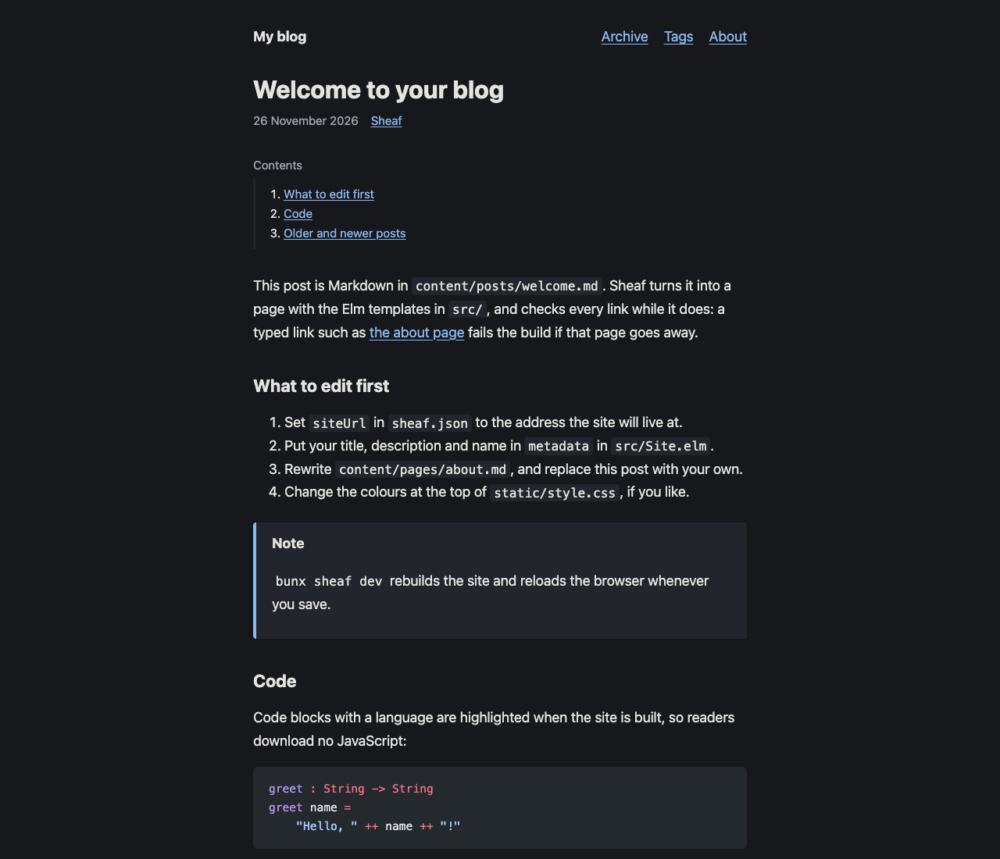

# Getting started

This page takes you from nothing to a blog running on your machine. It assumes
you know Elm; it doesn't assume you know Sheaf.

## What you need

- [Elm 0.19.3](https://guide.elm-lang.org/install/elm.html). Sheaf looks for
  `elm` in your site's `node_modules/.bin` first, then on your `PATH`, and
  stops with `WRONG ELM VERSION` if the one it finds isn't 0.19.3.
- Either [Bun](https://bun.sh) 1.4.5 or newer, or the standalone `sheaf`
  binary. Sheaf refuses an older Bun and tells you to run `bun upgrade`.

## Before the first release

Sheaf isn't published yet: neither the npm package `elm-sheaf` nor the Elm
package `ianramosc/elm-sheaf` is in its registry, and there are no binaries to
download, so the steps in [Install Sheaf](#install-sheaf) don't work yet.
Until they do, you run the CLI from a clone of the repository with Bun, and
your site uses that clone in place of both packages. You need Git too:

```sh
git clone https://github.com/IanRamosC/elm-sheaf.git
cd elm-sheaf/cli
bun install
cd ../..
bun elm-sheaf/cli/src/index.ts init my-blog --local elm-sheaf
```

The CLI is `cli/src/index.ts`, run with Bun. Once a site exists, the site has
its own `sheaf` command, so you only need the long form to create one. Skip to
[Create a site](#create-a-site), which explains `--local`.

## Install Sheaf

### With Bun

There is nothing to install: `bunx elm-sheaf` downloads Sheaf and runs it.
The site it creates lists Sheaf and Elm in its `package.json`, so `bun install`
in the site provides both, and `bunx sheaf` runs the site's own copy.

### As a standalone binary

The binary is Sheaf compiled together with Bun, so it needs no Bun. Download
the file for your system from the latest
[release](https://github.com/IanRamosC/elm-sheaf/releases):

| System | File |
|---|---|
| macOS on Apple Silicon | `sheaf-darwin-arm64` |
| macOS on Intel | `sheaf-darwin-x64` |
| Linux on x64 | `sheaf-linux-x64` |
| Linux on ARM64 | `sheaf-linux-arm64` |
| Windows on x64 | `sheaf-windows-x64.exe` |

On a Mac with Apple Silicon, take `sheaf-darwin-arm64`, never the x64 file,
which doesn't run under Rosetta on older versions of macOS. The x64 files need
a processor with SSE4.2, which nearly every x64 processor from the last fifteen
years has. The Linux files need glibc, so they don't run on Alpine Linux.

Each release also has a `SHA256SUMS` file. To check a download against it, put
both in one folder and run `shasum -a 256 -c --ignore-missing SHA256SUMS`
(`sha256sum -c --ignore-missing SHA256SUMS` on Linux).

On **macOS and Linux**, make the file executable, rename it `sheaf` and move it
into a folder on your `PATH`, such as `~/.local/bin`. With the Apple Silicon
file:

```sh
chmod +x sheaf-darwin-arm64
mkdir -p ~/.local/bin
mv sheaf-darwin-arm64 ~/.local/bin/sheaf
```

If `~/.local/bin` isn't on your `PATH`, add
`export PATH="$HOME/.local/bin:$PATH"` to your shell's profile, such as
`~/.zshrc`. On macOS, a file downloaded with a browser is quarantined, and
macOS refuses to open it because Apple can't check it for malicious software.
Clear the flag:

```sh
xattr -d com.apple.quarantine ~/.local/bin/sheaf
```

On **Windows**, rename the file `sheaf.exe` and move it into a folder on your
`PATH`. In PowerShell, this makes a folder for it and adds that folder to your
own `PATH`; open a new terminal afterwards:

```powershell
$folder = "$env:LOCALAPPDATA\Programs\sheaf"
New-Item -ItemType Directory -Force $folder
Move-Item sheaf-windows-x64.exe "$folder\sheaf.exe"
$path = [Environment]::GetEnvironmentVariable("Path", "User")
[Environment]::SetEnvironmentVariable("Path", "$path;$folder", "User")
```

The binary isn't signed, so SmartScreen may stop it with "Windows protected
your PC". Choose "More info", then "Run anyway". `Unblock-File "$folder\sheaf.exe"`
removes the mark Windows puts on downloaded files, so that it doesn't ask.

The binary doesn't contain Elm, and installs nothing into your site, so Elm
0.19.3 must be on your `PATH`. Install it from the
[Elm releases](https://github.com/elm/compiler/releases), or with npm:

```sh
npm install -g elm@0.19.3-0
```

`sheaf --version` checks that your shell finds Sheaf, and `elm --version` that
it finds Elm.

## Create a site

Create the site with `bunx elm-sheaf init my-blog`, or with
`sheaf init my-blog` if you installed the binary.

`init` creates `my-blog` if it doesn't exist. It refuses a folder that has
anything in it, hidden files included, with `FOLDER NOT EMPTY`, and writes
nothing.

The site's `elm.json` depends on the Elm package `ianramosc/elm-sheaf`, which
Elm downloads from the package website the first time it compiles the site,
and its `package.json` depends on `elm-sheaf` from npm, which `bun install`
installs.

`--local` makes the site use a clone of this repository instead, and must point
at one; anything else is `NOT A SHEAF REPOSITORY`. It changes two generated
files. `elm.json` lists the clone's `src` folder in its `source-directories`,
in place of the dependency on `ianramosc/elm-sheaf`. `package.json` depends on
the clone's `cli` folder as a `file:` dependency, in place of `elm-sheaf` from
npm. Both hold the clone's absolute path, so such a site works only on the
machine that made it. Use it to work on Sheaf itself, or to try it before the
first release.

Every Sheaf command checks `elm.json` before it generates anything. The file
must get the Sheaf Elm package exactly once: either `ianramosc/elm-sheaf` among
its direct dependencies at a version from 1.0.0 up to, but not including, 2.0.0,
or, as `--local` sets up, a source directory that holds `Sheaf.elm`. A site with
neither is `SHEAF PACKAGE MISSING`, one with both is `SHEAF PACKAGE TWICE`, and
a version outside the range is `UNSUPPORTED SHEAF VERSION`.

Then install the site's dependencies and start the development server:

```sh
cd my-blog
bun install
bunx sheaf dev
```

`bun install` installs Sheaf's CLI into the site, and the `elm` npm package,
which downloads Elm 0.19.3. With `--local`, it copies the `file:` dependency
rather than linking it, so after you pull or edit the clone's `cli/`, run
`bun install` in the site again.

With the binary, there is nothing to install into the site, because Elm and
`sheaf` both come from your `PATH`:

```sh
cd my-blog
sheaf dev
```

These are the steps `init` prints, with the folder in single quotes if its name
has spaces or characters the shell would read. The binary's steps begin with a
line asking you to install Elm 0.19.3 if it isn't on your `PATH`.

`sheaf dev` prints the address it serves the site at, such as
`http://127.0.0.1:4000/`. Open it, then edit `content/posts/welcome.md`: the
site rebuilds and the page reloads when you save.

The welcome post follows the reader's colour scheme:




## What's in the site

```
my-blog/
  sheaf.json              the site's address, and the few settings needed before Elm runs
  elm.json
  package.json
  README.md               how to run and publish the site
  .gitignore
  content/
    posts/welcome.md      a collection named "posts"
    pages/about.md        a collection named "pages"
  static/style.css        copied into the site as it is
  static/favicon.svg      the site's icon, Sheaf's logo until you replace it
  src/
    Site.elm              the site: metadata, frontmatter and which templates render what
    Theme/Layout.elm      the frame around every page
    Theme/Pages.elm       a template for each kind of page
    Theme/Components.elm  the callout component
  .github/workflows/deploy.yml   builds and deploys the site to GitHub Pages
```

Sheaf also writes a `.sheaf/` folder for generated Elm code and caches, and
`sheaf build` writes `dist/`. The starter's `.gitignore` leaves out both, with
`elm-stuff/` and `node_modules/`.

The welcome post lists what to change first:

1. Set `siteUrl` in `sheaf.json` to the address the site will live at.
2. Put your title, description and name in `metadata` in `src/Site.elm`.
3. Rewrite `content/pages/about.md`, and replace the welcome post with your own.
4. Change the colours at the top of `static/style.css`, if you like.

## When something is wrong

Sheaf reports problems with the file and line they come from, and lists every
problem of a kind at once, so ten broken links take one fix, not ten runs.
Change `pages:about` in the welcome post to `pages:abot`
and run `bunx sheaf check`:

```
-- BROKEN LINK ---------------------------------- content/posts/welcome.md:10:37

This document links to `pages:abot`, but no document in `pages` has that slug.

   10| typed link such as [the about page](pages:abot) fails the build if that page
                                           ^^^^^^^^^^

Did you mean one of these?

    pages:about

Found 1 error
```

While `sheaf dev` runs, the same report replaces the page in the browser until
you fix it.

## Next

- [Content](content.md): how documents, frontmatter, drafts, dates and links
  work.
- [Templates](templates.md): how `Site.elm` and the templates fit together.
- [Deploying](deploying.md): putting the site online.
