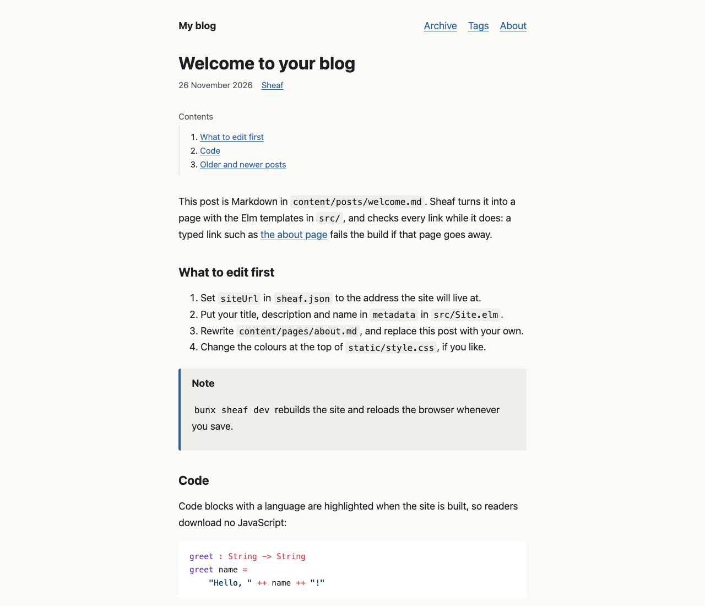

# Getting started

This page takes you from nothing to a blog running on your machine. It assumes
you know Elm; it doesn't assume you know Sheaf.

## What you need

- [Bun](https://bun.sh) 1.4.5 or newer. Sheaf refuses an older Bun and tells
  you to run `bun upgrade`.
- [Elm 0.19.3](https://guide.elm-lang.org/install/elm.html). Sheaf looks for
  `elm` in your site's `node_modules/.bin` first, then on your `PATH`, and
  stops with `WRONG ELM VERSION` if the one it finds isn't 0.19.3.
- Git, to get Sheaf itself.

## Get Sheaf

Sheaf isn't published yet: neither the npm package `elm-sheaf` nor the Elm
package `ianramosc/elm-sheaf` is in its registry. Until they are, you run the
CLI from a clone of the repository, and your site uses that clone in place of
both packages:

```sh
git clone https://github.com/IanRamosC/elm-sheaf.git
cd elm-sheaf/cli
bun install
```

The CLI is `cli/src/index.ts`, run with Bun. Once a site exists, the site has
its own `sheaf` command, so you only need the long form to create one.

## Create a site

Go back to the folder that holds the clone and create the site there:

```sh
cd ../..
bun elm-sheaf/cli/src/index.ts init my-blog --local elm-sheaf
```

`init` creates `my-blog` if it doesn't exist. It refuses a folder that has
anything in it, hidden files included, with `FOLDER NOT EMPTY`, and writes
nothing. `--local` must point at a clone of this repository; anything else is
`NOT A SHEAF REPOSITORY`.

`--local` changes two generated files. `elm.json` lists the clone's `src`
folder in its `source-directories`, in place of a dependency on
`ianramosc/elm-sheaf`. `package.json` depends on the clone's `cli` folder as a
`file:` dependency, in place of `elm-sheaf` from npm. Both hold the clone's
absolute path, so the site works only on the machine that made it until the
packages are published.

Every Sheaf command checks `elm.json` before it generates anything. The file
must get the Sheaf Elm package exactly once: either `ianramosc/elm-sheaf` among
its direct dependencies at a version from 1.0.0 up to, but not including, 2.0.0,
or, as `--local` sets up, a source directory that holds `Sheaf.elm`. A site with
neither is `SHEAF PACKAGE MISSING`, one with both is `SHEAF PACKAGE TWICE`, and
a version outside the range is `UNSUPPORTED SHEAF VERSION`.

Then install the site's dependencies and start the development server:

```sh
cd my-blog
bun install
bunx sheaf dev
```

`bun install` installs Sheaf's CLI into the site, and the `elm` npm package,
which downloads Elm 0.19.3. It copies a
`file:` dependency rather than linking it, so after you pull or edit the clone's
`cli/`, run `bun install` in the site again.

These are the steps `init` prints when it runs under Bun, with the folder in
single quotes if its name has spaces or characters the shell would read. The
standalone `sheaf` binary prints `cd my-blog` and `sheaf dev` instead, after a
line asking you to install Elm 0.19.3 if it isn't on your `PATH`: nothing is
installed into a site the binary uses, so Elm and `sheaf` both come from your
`PATH`.

`sheaf dev` prints the address it serves the site at, such as
`http://127.0.0.1:4000/`. Open it, then edit `content/posts/welcome.md`: the
site rebuilds and the page reloads when you save.

The welcome post follows the reader's colour scheme:




## What's in the site

```
my-blog/
  sheaf.json              the site's address, and the few settings needed before Elm runs
  elm.json
  package.json
  README.md               how to run and publish the site
  .gitignore
  content/
    posts/welcome.md      a collection named "posts"
    pages/about.md        a collection named "pages"
  static/style.css        copied into the site as it is
  src/
    Site.elm              the site: metadata, frontmatter and which templates render what
    Theme/Layout.elm      the frame around every page
    Theme/Pages.elm       a template for each kind of page
    Theme/Components.elm  the callout component
  .github/workflows/deploy.yml   builds and deploys the site to GitHub Pages
```

Sheaf also writes a `.sheaf/` folder for generated Elm code and caches, and
`sheaf build` writes `dist/`. The starter's `.gitignore` leaves out both, with
`elm-stuff/` and `node_modules/`.

The welcome post lists what to change first:

1. Set `siteUrl` in `sheaf.json` to the address the site will live at.
2. Put your title, description and name in `metadata` in `src/Site.elm`.
3. Rewrite `content/pages/about.md`, and replace the welcome post with your own.
4. Change the colours at the top of `static/style.css`, if you like.

## When something is wrong

Sheaf reports problems with the file and line they come from, and lists every
problem of a kind at once, so ten broken links take one fix, not ten runs.
Change `pages:about` in the welcome post to `pages:abot`
and run `bunx sheaf check`:

```
-- BROKEN LINK ---------------------------------- content/posts/welcome.md:10:37

This document links to `pages:abot`, but no document in `pages` has that slug.

   10| typed link such as [the about page](pages:abot) fails the build if that page
                                           ^^^^^^^^^^

Did you mean one of these?

    pages:about

Found 1 error
```

While `sheaf dev` runs, the same report replaces the page in the browser until
you fix it.

## Next

- [Content](content.md): how documents, frontmatter, drafts, dates and links
  work.
- [Templates](templates.md): how `Site.elm` and the templates fit together.
- [Deploying](deploying.md): putting the site online.
